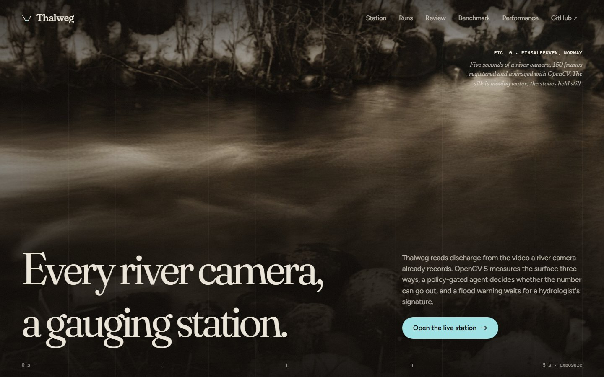
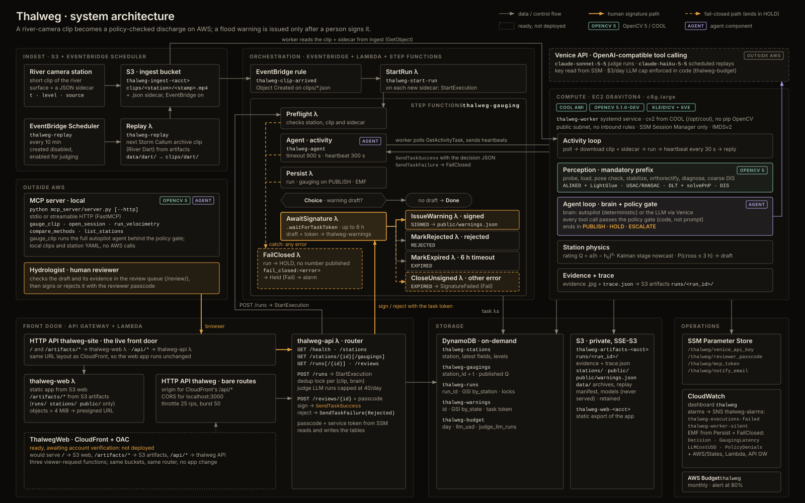

# Thalweg

**A camera is a stream gauge.** Thalweg reads river video with OpenCV 5 and turns it into a discharge measurement (m³/s). An agent decides whether the measurement can be trusted. When the evidence doesn't hold, it refuses to publish: it asks for a better clip or hands the case to a hydrologist. The station also keeps a rating curve and a stage nowcast. When a flood threshold is coming, it drafts a warning that only a person can sign.

- **Live station:** River Dart at Austins Bridge (UK), replaying Storm Callum (12 Oct 2018) → https://jp89re6ozf.execute-api.us-east-1.amazonaws.com/station/
- **Benchmark:** blind, against 15–23 human hydrologists on the 8 real videos of the Video Globe Challenge 2020 → [`eval/`](eval/)
- **Runs on:** AWS Graviton4 with COOL (Cloud-Optimized OpenCV), Step Functions, DynamoDB, S3, API Gateway



## Why

Floods affect more people than any other weather hazard, and the gauging network that tells us how much water is coming is thin. Gauging a river in flood with a current meter or an ADCP boat is slow, expensive and dangerous. Video gauging solves the cost and the danger: a camera, a few surveyed reference points and a cross-section are enough.

What it doesn't solve is the operator. Every frame step, window size, filter and coefficient is a manual choice. In the Video Globe Challenge 2020, 15–23 hydrologists measured the same eight videos. On a typical video their median error was 10–23%, and a few answers had the wrong sign. Bodart et al. (2023) showed that these parameter choices are the dominant error source. A camera network can't scale if every clip needs an expert.

Thalweg is that operator. It looks at each clip and chooses the method and parameters from what it sees. It cross-checks two independent measurements and publishes only on a basis the code can verify.

## How it measures (OpenCV 5)

| Step | What happens | OpenCV 5 |
|---|---|---|
| Camera check | The clip is compared with the station's surveyed reference view. A moved camera is escalated, never gauged. | `ALIKED_create` + `LightGlueMatcher_create`, robust fit |
| Stabilize | Hand-held, drone and vibrating cameras are registered to the reference frame on the banks only. | ALIKED + LightGlue, RANSAC similarity; phase correlation as a check |
| Orthorectify | Surveyed ground reference points give the camera model: a homography for planar points, DLT + `solvePnP` for 3D ones. Every frame is remapped onto the **water surface at the live water level**. That is a different plane at every stage. | `findHomography(USAC_MAGSAC)`, `solvePnP`, `projectPoints`, `remap` |
| Diagnose | Moving-tracer energy, static texture ("riverbed visible through clear water"), glare, darkness, blur and frozen frames, measured on the orthorectified water. | Laplacian, temporal high-pass, connected components |
| Velocimetry | Three independent methods: **LSPIV** (ensemble cross-correlation, sub-pixel Gaussian peak), **STIV** (space-time images; shift-and-add streak alignment), **dense DIS optical flow**. Each comes with a normalized median test. | `matchTemplate(TM_CCOEFF_NORMED)`, `remap`, `DISOpticalFlow` |
| Discharge | Velocity-area (midsection) over the surveyed cross-section: surface velocity × α × depth × width per panel, a depth²ᐟ³ fill for gaps, and an uncertainty budget. | numpy/scipy |

## The agent, and why it refuses

The mandatory perception steps always run first. A brain then chooses the next tool calls. It is either the deterministic **autopilot** or an **LLM** with tool calling and image input (Claude Sonnet 5.5, served by Venice). Every call passes a **policy gate written in code**:

- Parameters are bounded. Prerequisites must exist. There are step and time budgets.
- `publish_gauging` must name its basis. The gate checks that basis against the measured evidence:
  - `methods_agree`: two methods within 15%;
  - `bed_visible_prefers_stiv`: the static-texture ratio really is above 1.2;
  - `seeded_surface_prefers_lspiv`: the surface really is well seeded.

  Geometry, stabilization, coverage and image quality must also pass. A false basis is denied, the denial is recorded in the trace, and the brain must fix the problem or escalate.
- An LLM timeout, a malformed response, an exhausted daily budget or running out of steps or time leads to **HOLD**. A tool error goes back to the brain as evidence; the brain can retry with other parameters or stop. A failed mandatory perception step ends the run. Nothing ever produces a guessed number.
- There is no tool that issues a flood warning. After a published gauging, the station refits its rating curve (Q = a(h − h₀)ᵇ) and runs a constant-velocity Kalman nowcast on the stage. If the probability of crossing the warning threshold within 3 h is at least 0.5, it **drafts** a warning. A Step Functions `waitForTaskToken` holds it until a hydrologist signs or rejects it in the review queue (6 h expiry).

Every run leaves a trace: each tool call, its arguments and stated reason, the policy verdict, the evidence images and the decision. The trace shows the OpenCV output changing the next action; annotated examples are in [docs/agentic-evidence.md](docs/agentic-evidence.md).

## Results

### Blind benchmark: Video Globe Challenge 2020

Videos 1 and 8 were used for development. The agent, policy and parameters were then frozen (`git tag eval-freeze`). Videos 2–7 (two ground cameras, one 3D-surveyed bank camera, one more ground camera and three drone flights over rivers in France, Norway and Australia) were scored once per brain. The scorer reads the reference discharges; the pipeline never does. Every run is appended to [`eval/runs.jsonl`](eval/runs.jsonl).

| Video | Reference (m³/s, ±U) | Experts: median abs. error | Autopilot (rank) | LLM agent (rank) |
|---|---|---|---|---|
| 2 · West Normanby (AU), drone | 107.945 ±6% | 16.2% (n=17) | +17.9% (12/18) | +25.7% (14/18) |
| 3 · Séran (FR), 3D bank camera | 55.16 ±6% | 22.4% (n=18) | -7.0% (5/19) | -1.6% (1/19) |
| 4 · Russell River (AU), drone | 139 ±15% | 10.5% (n=22) | *escalated*, est. +1.1% (3/23) | *escalated*, est. -42.5% (21/23) |
| 5 · Storåne (NO), hand-held | 19.7 ±5% | 13.4% (n=23) | +23.1% (22/24) | +27.8% (24/24) |
| 6 · Groin (FR), 3D bank camera | 53.74 ±9% | 17.7% (n=17) | +3.2% (5/18) | +3.2% (5/18) |
| 7 · Herbert River (AU), drone | 962.8 ±5% | 2.2% (n=15) | -14.3% (13/16) | -3.0% (9/16) |

Rank = position among the experts plus our answer, by absolute error (1 is best).

- **Frozen autopilot, no LLM:** published 5/6, mean absolute error **13.1%** on the published gaugings, better than the median expert on 3/6 videos, ahead of 52% of the experts on average.
- **Frozen LLM agent:** best of all 19 answers on video 3 (−1.6%), 3/5 published values inside the reference uncertainty, mean absolute error 12.3%.
- **Both escalated video 4.** LSPIV and STIV disagreed and the diagnostics gave no basis to prefer one. The autopilot's unpublished estimate was +1.1%.
- **v1.1 autopilot (not blind):** stabilization on every frame drops the published error to 9.5%, with drone video 2 at +5.1%, 3rd of 18. It also exposes the open hand-held issue on development video 8 (report §8.3).

Full per-video results, including the experts' errors and our unpublished estimates: [`eval/results/benchmark.json`](eval/results/benchmark.json).

### Refusal suite

Real clips corrupted in known ways, each with the decision the agent must reach: night, glare, frozen feed, still water, camera moved, level above the banks, hand-held shake, and clean controls. The number that matters is **wrong publications: 0**, in every run. The first frozen run also exposed real robustness bugs. A dark frame was reported as a moved camera, and stabilization was rejected on hand-held footage. They were fixed in v1.1, and both versions are published.

| Run | Correct decisions | Wrong publications |
|---|---|---|
| refusal-autopilot | 6/9 | 0 |
| refusal-llm-sonnet | 6/9 | 0 |
| refusal-autopilot-v1.1 | 9/9 | 0 |
| refusal-llm-sonnet-v1.1 | 9/9 | 0 |

### Live station: River Dart, Storm Callum

The River Dart station replays real footage from Austins Bridge (Perks 2024, CC BY 4.0) through the deployed cloud pipeline: S3 → Step Functions → the Graviton4 worker. That covers 36 clips spread over July–December 2018, used to seed the station's own rating curve, and the 36 daylight clips of Storm Callum (11–12 October 2018). There is no reference ADCP gauging during the storm. As an independent cross-check we compare against the published camera analysis of the same clips (KLT-IV, Perks 2024).

- **Published gaugings:** 19 of 72 clips. Most refusals are on glassy summer low flow, where the two methods disagree, and at the peak, where the river left the surveyed section.
- **Storm rising limb, 06:52–09:22 on 12 October:** 7 published gaugings from 5.2 to 17.3 m³/s. Six of them are within ±9% of the KLT-IV analysis.
- **High flow, 10:37–14:52:** 59, 99 and 81 m³/s, which is 24–35% below KLT-IV. Part of the near half of the section is outside the camera view and is filled from the measured panels. We have not resolved which of the two analyses is closer to the true discharge.
- **All 19:** median absolute difference from KLT-IV 21%, and 9 of 19 within 20%.
- **The warning:** after the 11:22 gauging (stage 4999.84 m, rising 63 cm/h), the station's own rating curve put the QMED threshold of 231 m³/s at stage 5000.64 m. The nowcast gave 1.3 h to reach it, and the station drafted a warning that now waits in the review queue. At 12:52 the stage passed the bank tops of the surveyed section; the agent escalated instead of extrapolating. The stage then crested at 5000.39 m, 25 cm short of that threshold: by the station's own rating, Storm Callum stayed just under QMED. The KLT-IV analysis peaks at 222 m³/s, also just under. A straight-line nowcast cannot see a crest coming, and that is why the draft goes to a person.
- **The decision that drafted it:** LSPIV and STIV disagreed, so the LLM brain ran dense optical flow as a third opinion and published the agreeing pair (DIS 95.0, STIV 104.0 m³/s).

### Performance: COOL on Graviton4

| Build | s per clip (median of 5) | clips / hour | $ / 1000 gaugings |
|---|---|---|---|
| Graviton4 `c8g.large`, COOL (OpenCV 5.1.0-dev, KleidiCV 0.7, SVE baseline) | 38.9 | 93 | 0.97 |
| Graviton4 `c8g.large`, pip `opencv-python-headless==5.0.0.93` (KleidiCV 26.03) | 37.7 | 95 | 0.84 |
| x86 `c7i.large`, pip `opencv-python-headless==5.0.0.93` | 39.7 | 91 | 0.98 |

| Operation (ms, median) | COOL | pip, Graviton4 | pip, x86 |
|---|---|---|---|
| `resize_area_4k_to_1080p` | 17.696 | 17.718 | 35.519 |
| `dis_flow_600` | 16.514 | 17.451 | 30.554 |
| `matchTemplate_31_in_55_x100` | 6.971 | 6.298 | 4.217 |
| `remap_ortho_600x600` | 0.414 | 0.417 | 0.684 |
| `warpPerspective_1080p` | 4.039 | 3.271 | 3.975 |
| `phaseCorrelate_600` | 7.118 | 8.171 | 3.846 |
| `cvtColor_bgr2gray_1080p` | 0.34 | 0.324 | 0.621 |

The workload is one complete gauging of an 8-second clip (VGC video 1) by the deterministic agent: stabilization, orthorectification, diagnostics, LSPIV, STIV and discharge. All three builds return the same decision, and the two Arm builds return the same discharge to four decimals. The x86 build differs in the third decimal.

**What we found.** On this workload, COOL is not faster than the stock OpenCV 5 wheel on the same Graviton4 instance (38.9 s vs 37.7 s). The pip wheel for aarch64 already ships KleidiCV, in a newer version than the COOL build, and our time goes into ensemble correlation, ALIKED/LightGlue inference and numpy, not the colour, resize and contour kernels COOL targets. Graviton4 itself is the saving: the same gauging costs about 15% less than on x86 (c7i). The production worker runs COOL; `bench/results/` records which `cv2` ran, its HAL, the instance type and the AMI product code for each build. The obvious next step is our own kernels: LSPIV and STIV are Python loops around OpenCV calls and are the two largest stages.

## AWS



- **Ingest:** a station uploads a clip and a sidecar (`t`, `level`) to S3. EventBridge then starts the `thalweg-gauging` state machine.
- **Worker:** one EC2 `c8g.large` (Graviton4) from the COOL Marketplace AMI. It polls a Step Functions activity, runs the agent with COOL's OpenCV 5.1 build (KleidiCV + SVE), and writes evidence images and the trace to S3. It is reached only through SSM; there are no inbound ports.
- **State:** DynamoDB (stations, gaugings, runs, warnings, the LLM budget). Secrets are SecureStrings in SSM Parameter Store.
- **Human signature:** `waitForTaskToken`. The review API calls `SendTaskSuccess` / `SendTaskFailure`, and a draft expires after 6 h.
- **Operations:** CloudWatch dashboard, EMF metrics (decisions by kind, latency, policy denials, LLM cost), alarms on failed executions and a silent worker, and an AWS Budget on the `project=thalweg` tag. Everything is defined in AWS CDK ([`infra/`](infra/)).

## Run it

```bash
uv venv --python 3.12 && uv pip install -r requirements-dev.lock && uv pip install --no-deps -e .
python scripts/fetch_models.py                 # ALIKED + LightGlue ONNX (52 MB, SHA-1 checked)
python scripts/fetch_data.py vgc2020           # Video Globe Challenge 2020 (1.1 GB, etalab-2.0)
export THALWEG_DATA=~/.cache/thalweg/data
thalweg gauge --station stations/vgc1.yaml --clip clips/vgc1.json --brain autopilot
pytest -q
```

The LLM brain needs `VENICE_API_KEY` (`--brain llm`). The MCP server (`python mcp_server/server.py`) exposes the gauging tools to any MCP client.

## Honest limits

- Stage (water level) comes from the station's level sensor or the dataset; Thalweg does not read it from the image.
- Cross-sections and reference points are surveyed inputs. A station whose survey is wrong will be gauged wrong. The camera-pose check only catches the camera moving.
- The surface coefficient α is the station's value (0.85 by default). It is not measured.
- The benchmark has six held-out videos. That is enough to compare with the experts on the same footage, not enough for a general accuracy claim.
- Storm Callum is a replay of archived footage, not a live feed. Times on the live station are 2018 clip times.
- The warning threshold is the NRFA QMED for the Dart at Austins Bridge (231.2 m³/s), a hydrologically meaningful flood index. It is not the Environment Agency's operational trigger.

## Data and credits

- Video Globe Challenge 2020: Bodart, Le Coz, Jodeau, Hauet (2023), doi:10.57745/KVNIHX, etalab-2.0. Videos supplied by EDF, DREAL Auvergne-Rhône-Alpes, NVE and DNRME Queensland.
- River Dart image velocimetry: Perks (2024), doi:10.25405/data.ncl.19762027, CC BY 4.0.
- Flow statistics: UK National River Flow Archive, station 46003.
- ALIKED / LightGlue ONNX models via the OpenCV test-data collection.

MIT licensed.
