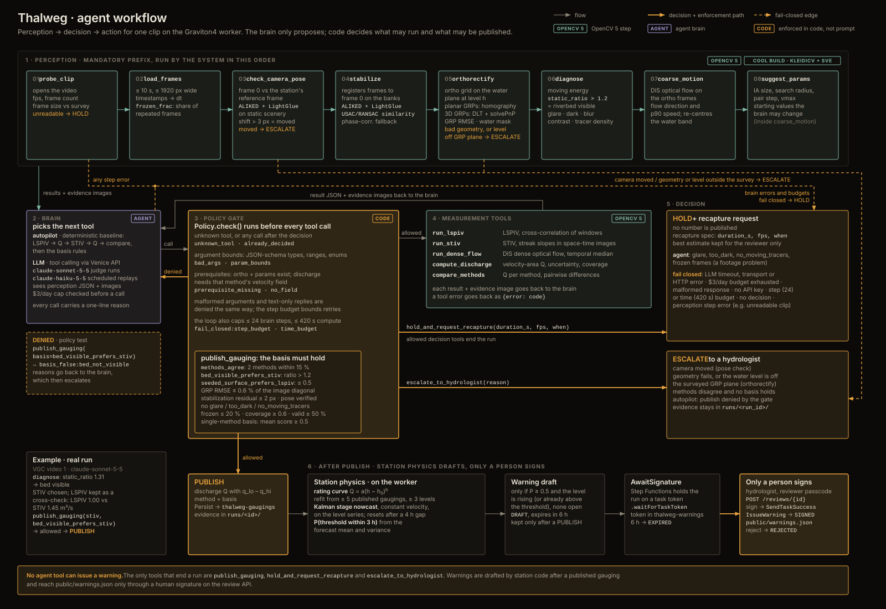

# Agentic Vision: where OpenCV output changes the next action

The award asks for a trace showing that OpenCV 5 output changes a later decision, tool call or action. Below are real runs. Each step in a trace has the tool, its arguments, the brain's stated reason, the policy verdict and the evidence images. The live ones open in the run page: `<site>/run/?id=<run_id>`.

## 1. A visible riverbed changes the method (VGC video 3, blind run)

Trace: [`eval/results/vgc-llm-sonnet/vgc3.trace.json`](../eval/results/vgc-llm-sonnet/vgc3.trace.json)

1. `diagnose` (OpenCV: temporal high-pass, spatial high-pass of the temporal mean) reports `static_ratio 1.56`, flag `bed_visible`.
2. The LLM runs `run_stiv` first. Its stated reason: "static_ratio 1.56 (bed_visible), so STIV with temporal high-pass is the robust method".
3. It then runs `run_lspiv` as a cross-check: "I expect it to be biased low because the bed is visible."
4. `compute_discharge` gives STIV 54.3 and LSPIV 47.5 m³/s.
5. `publish_gauging(method=stiv, basis=bed_visible_prefers_stiv)`. The gate re-checks `static_ratio > 1.2` from the measurement, not from the claim, and allows it.

The result is −1.6% against the ADCP reference, the best of all 19 answers on this video, including 18 hydrologists.

## 2. Methods disagree, so a third opinion is run (River Dart, Storm Callum, 11:22)

Live run: `r-20261026015143-931177`

1. LSPIV and STIV differ by more than the 15% tolerance.
2. The LLM calls `run_dense_flow` (OpenCV DIS optical flow) as an independent third method.
3. It publishes on `methods_agree`: "Dense flow (95.0 m³/s) agrees with STIV (104.0, 9% apart)…"
4. The station refits its rating curve and runs the stage nowcast. P(QMED stage within 3 h) ≥ 0.5, so a warning is drafted, and the Step Functions execution then waits on a task token for a person.

## 3. Geometry says no number is possible (River Dart, 12:52)

Live run: `r-20261026015803-223d33`

The measured water level is above the bank tops of the surveyed cross-section. `orthorectify` raises `level_out_of_range` before any velocimetry runs, and the run escalates to a hydrologist. No discharge is extrapolated outside the survey.

## 4. The flow direction contradicts the survey (River Dart, glassy low flow)

Live runs: `r-20261026012351-162063`, `r-20261026020214-5eedb6`

1. On clear, slow water the DIS probe points across the channel.
2. The axis guard records it, and the LLM reads that note with the evidence images. STIV and LSPIV disagree on direction, so it escalates instead of publishing a number built on a wrong axis.

## 5. A false basis is denied by code (test)

[`tests/agent/test_agent.py::test_false_basis_is_denied_then_escalated`](../tests/agent/test_agent.py)

1. A scripted brain claims `bed_visible_prefers_stiv` on a surface with no visible bed.
2. The gate returns `basis_false:bed_not_visible`.
3. The brain must then fix the evidence or escalate, and it escalates.

## Failure handling, observability, human control

- **Fail closed.** LLM timeout, budget, malformed output, a step or time budget, or a perception failure each end in HOLD or ESCALATE. See `thalweg/agent/loop.py` and the refusal suite (0 wrong publications).
- **Observability.** Per-step trace streamed to S3 while the run executes (`progress.json`); CloudWatch EMF metrics for decisions by kind, latency, policy denials and LLM cost; a dashboard and alarms.
- **Human control.** Warning drafts need a signature (`waitForTaskToken`, passcode, 409 on a non-draft, 6 h expiry). No agent tool can reach that path.
