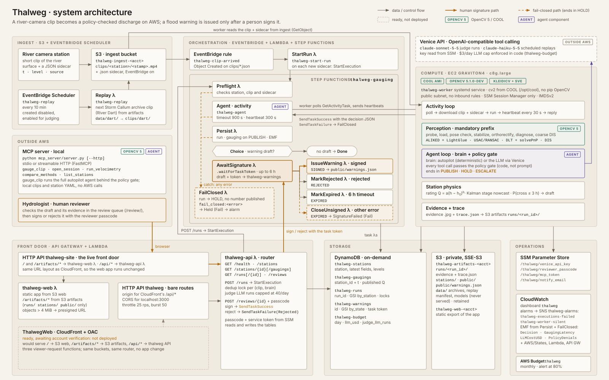
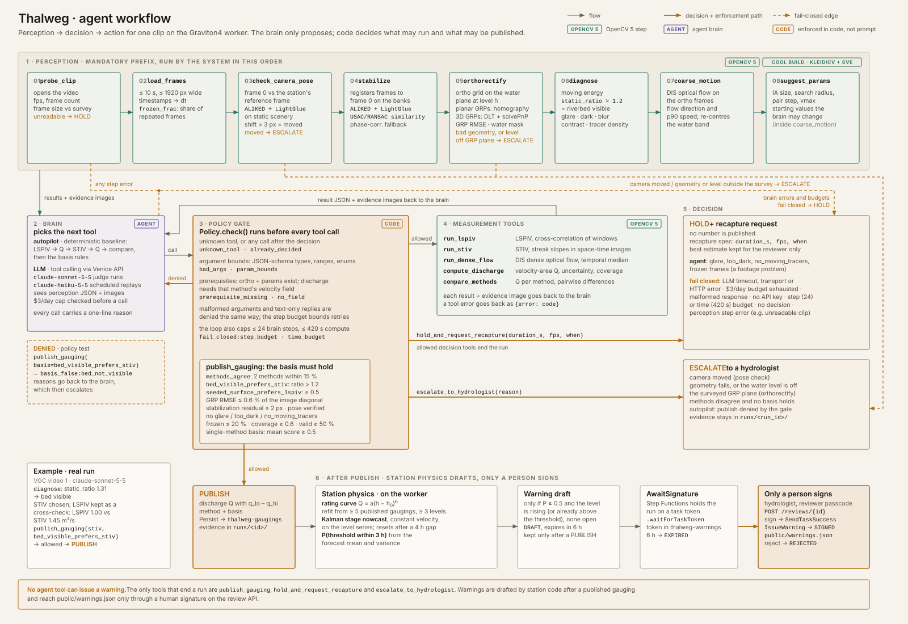

# Thalweg: technical report

*Camera-based river discharge with OpenCV 5 and a policy-gated agent on AWS.*
OpenCV AI Competition 2026 (Agentic Vision path, with COOL on Graviton4).

## 1. Problem

The one number a flood forecaster needs is how much water is coming: discharge, in m³/s. It comes from gauging stations. A rating curve turns a water level into discharge, and the curve has to be checked by direct gaugings. Those are made with a current meter or an ADCP boat, often during floods, from bridges or in the water. The work is slow, expensive and dangerous, and in much of the world the network is thin or shrinking.

Image velocimetry measures the surface velocity of a river from video and, with a surveyed cross-section, its discharge. LSPIV and STIV are established techniques, used operationally by EDF, the USGS and several national services. They need no contact with the water and work best exactly when manual gauging is hardest: in high, turbid, debris-laden flow.

The barrier is the operator. Every video gauging involves choices: orthorectification resolution, interrogation and search windows, frame interval, filters, the surface coefficient, and which method to trust. The Video Globe Challenge 2020 (VGC2020) gave the same eight videos to 15–23 hydrologists. Their answers spread widely. The median absolute error per video ranged from 2% to 23%, and two participants returned negative discharges. Bodart et al. (2023) attribute most of this to parameter choices, which they call the operator effect. A network of thousands of cameras cannot have an expert behind every clip.

## 2. Users

- **Hydrometry teams** in national and regional services. They want unattended gauging from cameras already installed, and they want to be asked only when it matters.
- **Hydropower and water-utility operators** who need discharge at intakes and spillways.
- **Municipal and NGO projects** in ungauged basins, where a phone or a cheap IP camera is the only affordable sensor.
- **Flood forecasters**, who need to trust the number and see why a warning was proposed.

## 3. System overview

A station uploads a short clip (10–60 s) and a sidecar with the time and the water level measured by its stage sensor. The clip lands in S3, and EventBridge starts a Step Functions workflow. The workflow sends the job to a Graviton4 worker running the COOL build of OpenCV. On the worker the agent measures the clip and decides `PUBLISH`, `HOLD` or `ESCALATE`, writing evidence images and a trace. A published gauging updates the station's rating curve and stage nowcast. When the nowcast says a flood threshold is likely within three hours, the station drafts a warning. The workflow then pauses on a task token until a hydrologist signs or rejects it in the web app.

## 4. OpenCV 5 implementation

All perception and measurement is OpenCV 5 (`opencv-python-headless==5.0.0.93` for development; COOL's OpenCV 5.1.0-dev build on the worker).

**4.1 Camera check and stabilization.**
- **Features and matching.** Features come from **ALIKED**, matched with **LightGlue** (`cv.ALIKED_create`, `cv.LightGlueMatcher_create`; ONNX models run by the new DNN engine).
- **Camera check.** Each clip is compared with the station's surveyed reference view, and a shift above 3 px escalates the run. If the view cannot be compared at all (night, fog), it is *unverified*, not *moved*. Image quality then decides, and the policy will not publish an unverified pose.
- **Stabilization.** Keyframes are registered to the reference on the banks only, using a robust similarity fit. Every frame in between is registered to its keyframe by forward–backward Lucas–Kanade tracking of static points. Borders are left empty, never replicated, and only pixels seen in every frame take part in the measurement.

**4.2 Camera model and orthorectification.**
- **Planar GRPs** give a homography (`findHomography`, USAC MAGSAC). That model is valid only on the GRP plane, and the code refuses any other level (`planar_grp_level_mismatch`).
- **3D GRPs** give a normalised DLT, decomposed to seed `solvePnP`. Where intrinsics are known or fitted (the River Dart CCTV camera: f and k₁ fitted to nine GCPs), the model uses `solvePnP` in survey-centred coordinates.
- **Drone footage** with a known ground-sampling distance is scaled directly.
- **The water plane moves.** Frames are remapped (`cv.remap`) onto a metric grid on the **water surface at the measured level**, which is a different plane every time the river rises.

**4.3 Diagnostics.** These are measured on the orthorectified water inside the gauging band:
- moving-tracer energy (temporal high-pass);
- static texture, as a ratio to the moving energy. A high ratio means the riverbed shows through clear water, which pins correlation methods to zero;
- glare, darkness, blur, contrast, and frozen frames.

**4.4 Velocimetry.** There are three independent methods. Coarse DIS optical flow on a few frame pairs sets their parameters (pair step for ~4 px displacement, interrogation window, search radius, flow direction):
- **LSPIV.** For each interrogation area, the normalised cross-correlation maps (`matchTemplate`) of up to 150 frame pairs are averaged before the peak is found (ensemble correlation). The peak is located to sub-pixel accuracy with a three-point Gaussian fit.
- **STIV.** Space–time images are sampled with `remap` along lines parallel to the flow, three per transect panel. The streak slope is found by shift-and-add over short windows, normalised by the interpolated row variance; without that normalisation the answer locks to whole pixels. A temporal high-pass removes static texture first.
- **Dense flow.** DIS optical flow, temporal median.

Vectors pass a score threshold, a speed bound, a direction gate and the normalised median test.

**4.5 Discharge.** This is the velocity-area (midsection) method. The wetted section is cut at the measured level, and 20 panels each take the median surface velocity normal to the section. Panels without vectors are filled from the nearest measured panel, scaled by depth²ᐟ³, and flagged. Discharge is α × surface velocity × depth × width summed over the panels. The uncertainty budget combines α, velocity sampling, the interpolated share and the level.

**Validation on synthetic flows** (`tests/`). On advected texture with exact velocity, short-lived features and a static "riverbed", LSPIV and STIV recover the speed within 3–5%. A synthetic channel run end to end through the agent recovers the analytic discharge within 8%.

## 5. The agent

**Loop.**
- The mandatory perception steps always run first.
- A brain then proposes tool calls. It is either the deterministic *autopilot*, or an *LLM* with tool calling and image input (Claude Sonnet 5.5 for on-demand runs, Haiku 5.5 for scheduled replays), served through the Venice API.
- The LLM sees the diagnostics, the parameter suggestion, and evidence images (frame overlay, ortho, vector fields, the space-time image). It chooses methods and parameters and decides when to stop.

**Policy gate (code).**
- Every call is checked for argument types and bounds, prerequisites, and step and time budgets.
- Publication requires a stated **basis**, and the gate verifies that basis against the measured diagnostics:
  - `methods_agree`: two methods within 15%;
  - `bed_visible_prefers_stiv`: static ratio > 1.2;
  - `seeded_surface_prefers_lspiv`: static ratio ≤ 0.5.
- Geometry (GRP reprojection under 0.6% of the image diagonal), stabilization, coverage ≥ 0.6, valid vectors and image quality must also pass. Denials are returned to the brain and written to the trace.

**Fail closed.**
- An LLM timeout, transport error, malformed output, an exhausted daily budget, or running out of steps or time leads to `HOLD`. Tool errors are returned to the brain as results; the brain may retry or stop.
- A moved camera, a water level outside the surveyed section (checked before any measurement), or a degenerate camera model leads to `ESCALATE`.

**No warning tool.** Warnings are drafted by station logic after a published gauging. The draft is held by a Step Functions task token, and only a person can resolve it through the review API (passcode, 409 on a non-draft, 6 h expiry).

**Traces.** Every step is recorded: tool, arguments, the brain's stated reason, the policy verdict, the result summary, evidence image keys and timing. The traces are the evidence that OpenCV output changes later decisions. For example, on VGC video 1 the diagnostics report static ratio 1.31. The LLM then runs STIV first and keeps LSPIV only as a cross-check ("biased low with bed visible": Q 1.00 vs 1.45). It then publishes on `bed_visible_prefers_stiv`, a basis the gate verifies.

## 6. Station physics and warnings

- **Rating curve.** Q = a(h − h₀)ᵇ, fitted by bounded least squares to the station's own published gaugings and refitted after each one. A new gauging far from the curve (relative residual > 3σ) is a sign of a shifted control or a bad measurement.
- **Nowcast.** A constant-velocity Kalman filter runs on the stage series. It resets after gaps longer than 4 h; daylight-only footage leaves night gaps. A constant-acceleration model was tried and rejected: its 6-hour variance turned every threshold into a coin flip.
- **Warning draft.** A warning is drafted when P(stage > threshold stage at +3 h) ≥ 0.5, or the stage is already above it. The threshold for the River Dart is the NRFA QMED for station 46003 (231.2 m³/s), mapped to a stage through the rating curve. On the Storm Callum stage series this rule would have drafted a warning at 10:30 on 12 October 2018, about 1.5 h before the stage passed the QMED level.

## 7. AWS deployment

- **Compute.** One EC2 `c8g.large` (Graviton4) from the COOL Marketplace AMI, managed by SSM with no inbound ports. A systemd worker long-polls the Step Functions activity, heartbeats, and reports success or failure.
- **Orchestration.** Step Functions Standard: Preflight → Agent (activity, 15 min, heartbeat) → Persist → Choice → AwaitSignature (`waitForTaskToken`, 6 h) → IssueWarning / Rejected / Expired, plus FailClosed on any error.
- **Data.** S3 (ingest, artifacts, web; SSE-S3, public access blocked); DynamoDB on demand (stations, gaugings, runs, warnings, budget); SSM SecureStrings for the LLM key, reviewer passcode and service token.
- **Interfaces.** An API Gateway HTTP API with a Python router (reads, `POST /runs` idempotent while running, a 40/day cap on judge-triggered LLM runs, `POST /reviews/{id}`), and a second HTTP API that serves the static site and proxies evidence images. A CloudFront distribution is defined and tested in CDK. It is not deployed because the account is awaiting CloudFront verification.
- **Operations.** EventBridge Scheduler replays the Storm Callum archive into ingest every 15 minutes. CloudWatch provides a dashboard, EMF metrics (decisions by kind, latency, policy denials, LLM cost) and alarms (failed executions, silent worker). An AWS Budget on the `project=thalweg` tag and a $3/day LLM cap are enforced in code.
- **Infrastructure as code.** AWS CDK (TypeScript), with 8 assertion tests and 78 handler tests.

## 8. Evaluation

### 8.1 Benchmark protocol
- **Data.** VGC2020: eight real videos (five ground cameras, three drones) from France, Norway and Australia. Each has a reference discharge (ADCP, dilution or rating) with its uncertainty, and the answers of 15–23 participants.
- **Development and freeze.** Videos 1 and 8 were used for development. The agent, policy and parameters were then frozen (git tag `eval-freeze`). Videos 2–7 were scored once per brain.
- **No peeking.** Station configs for 2–7 were built from survey inputs only, without opening any results. Only `eval/` reads the answer key.
- **Logging.** Every run is appended to `eval/runs.jsonl`.

| Video | Reference (m³/s, ±U) | Experts: median abs. error | Autopilot (rank) | LLM agent (rank) |
|---|---|---|---|---|
| 2 · West Normanby (AU), drone | 107.945 ±6% | 16.2% (n=17) | +17.9% (12/18) | +25.7% (14/18) |
| 3 · Séran (FR), 3D bank camera | 55.16 ±6% | 22.4% (n=18) | -7.0% (5/19) | -1.6% (1/19) |
| 4 · Russell River (AU), drone | 139 ±15% | 10.5% (n=22) | *escalated*, est. +1.1% (3/23) | *escalated*, est. -42.5% (21/23) |
| 5 · Storåne (NO), hand-held | 19.7 ±5% | 13.4% (n=23) | +23.1% (22/24) | +27.8% (24/24) |
| 6 · Groin (FR), 3D bank camera | 53.74 ±9% | 17.7% (n=17) | +3.2% (5/18) | +3.2% (5/18) |
| 7 · Herbert River (AU), drone | 962.8 ±5% | 2.2% (n=15) | -14.3% (13/16) | -3.0% (9/16) |

Rank = position among the experts plus our answer, by absolute error.

**Reading the results.**
- **Frozen autopilot (no LLM, no per-site tuning).** It published 5 of 6 held-out videos. It beat the median expert on 3 of 6 and beat 52% of the experts on average. Its mean absolute error on published gaugings was 13%.
- **LLM brain.** It was the best of all 19 answers on video 3 (−1.6%) and landed within the reference uncertainty on 3 of 5 published videos. It also made larger errors on videos 2 and 5.
- **Russell River (drone, video 4).** Both brains escalated it: the two methods disagreed and the diagnostics gave no basis to prefer one. The autopilot's unpublished estimate was +1.1%. That is the price of refusing on disagreement, and we think it is the right one.

### 8.2 Refusal suite
Real clips are corrupted in known ways, and each case has the decision the agent must reach. The cases cover night, glare, a frozen feed, still water, a moved camera, a level above the banks, hand-held shake, and clean controls.

| Run | Correct decisions | Wrong publications |
|---|---|---|
| refusal-autopilot | 6/9 | 0 |
| refusal-llm-sonnet | 6/9 | 0 |
| refusal-autopilot-v1.1 | 9/9 | 0 |
| refusal-llm-sonnet-v1.1 | 9/9 | 0 |

The frozen build made **no wrong publications**. It still missed three expected decisions:
- a dark clip was escalated as a "moved camera";
- a hand-held clip's stabilization was rejected, so a clean control was escalated.

These were fixed in v1.1 (pose "unverified" ≠ "moved"; per-frame stabilization). The v1.1 results are reported separately and are **not** blind.

### 8.3 Failure cases we found
- **Hand-held footage and GRPs (VGC video 8).** The camera drifts several hundred pixels during the clip. v1.1 registers every frame to the first one and measures 1.11 m³/s against a 0.636 reference. The frozen build, which did not stabilize this clip, measured 0.78. The dataset does not say which frame the GRP pixels were picked on. A gauging from a moving camera is only as good as that answer, so the station config should state its reference frame. This is the clearest open issue.
- **Wind (VGC video 5).** The site note prescribes α = 1.0 because of a strong upstream wind. Both brains used it and overestimated by 23–28%.
- **Drone footage over wide rivers (videos 2 and 7).** The static-texture diagnostic also responds to banks and shallows in the band, not only to a visible riverbed, so STIV was preferred more often than it should be.

### 8.4 COOL on Graviton4

| Build | s per clip (median of 5) | clips / hour | $ / 1000 gaugings |
|---|---|---|---|
| Graviton4 `c8g.large`, COOL (OpenCV 5.1.0-dev, KleidiCV 0.7, SVE baseline) | 38.9 | 93 | 0.97 |
| Graviton4 `c8g.large`, pip `opencv-python-headless==5.0.0.93` (KleidiCV 26.03) | 37.7 | 95 | 0.84 |
| x86 `c7i.large`, pip `opencv-python-headless==5.0.0.93` | 39.7 | 91 | 0.98 |

| Operation (ms, median) | COOL | pip, Graviton4 | pip, x86 |
|---|---|---|---|
| `resize_area_4k_to_1080p` | 17.696 | 17.718 | 35.519 |
| `dis_flow_600` | 16.514 | 17.451 | 30.554 |
| `matchTemplate_31_in_55_x100` | 6.971 | 6.298 | 4.217 |
| `remap_ortho_600x600` | 0.414 | 0.417 | 0.684 |
| `warpPerspective_1080p` | 4.039 | 3.271 | 3.975 |
| `phaseCorrelate_600` | 7.118 | 8.171 | 3.846 |
| `cvtColor_bgr2gray_1080p` | 0.34 | 0.324 | 0.621 |

The workload is one complete gauging of an 8-second clip (VGC video 1) by the deterministic agent: stabilization, orthorectification, diagnostics, LSPIV, STIV and discharge. All three builds return the same decision, and the two Arm builds return the same discharge to four decimals. The x86 build differs in the third decimal.

**What we found.** On this workload, COOL is not faster than the stock OpenCV 5 wheel on the same Graviton4 instance (38.9 s vs 37.7 s). The pip wheel for aarch64 already ships KleidiCV, in a newer version than the COOL build, and our time goes into ensemble correlation, ALIKED/LightGlue inference and numpy, not the colour, resize and contour kernels COOL targets. Graviton4 itself is the saving: the same gauging costs about 15% less than on x86 (c7i). The production worker runs COOL; `bench/results/` records which `cv2` ran, its HAL, the instance type and the AMI product code for each build. The obvious next step is our own kernels: LSPIV and STIV are Python loops around OpenCV calls and are the two largest stages.

### 8.5 Live station (River Dart, Storm Callum)

<!--DART-->

## 9. Limitations

- Stage comes from the station's level sensor or the dataset; it is not read from the image.
- Survey inputs (GRPs, cross-section) are trusted. Only camera motion is checked against them.
- α is a station constant. Wind and secondary currents violate it, as video 5 shows.
- Six held-out videos are enough to compare with experts on the same footage, not enough for a general accuracy claim.
- The live station replays archived footage with its 2018 timestamps; it is not a live feed.
- One worker means one clip at a time. Scaling out is a matter of more workers polling the same activity, but we have not load-tested that.

## 10. Responsible use

- **Human authority over warnings.** No code path issues a public warning without a person. The agent cannot reach that path, and the review API enforces a passcode, state checks and expiry.
- **Refusal over guessing.** Every failure mode holds or escalates. The unpublished estimates are kept for reviewers and never shown as gaugings.
- **Privacy.** The footage shows rivers. Stations should be sited and masked so that people and number plates are not in the gauging band. Thalweg stores only the clips, evidence crops of the water surface, and the measurements.
- **Cost and abuse controls.** LLM spend is capped per day in code, judge-triggered runs are rate-limited, the worker has no inbound ports, and IAM is least-privilege.
- **Data licences.** VGC2020 is etalab-2.0, the River Dart deposit is CC BY 4.0, and NRFA statistics are used under its terms. All are credited.

## References

- Bodart G., Le Coz J., Jodeau M., Hauet A. (2023). *Quantifying and reducing the operator effect in LSPIV discharge measurements.* Water Resources Research. Dataset doi:10.57745/KVNIHX.
- Le Coz J., Hauet A., Despax A. (2021). *The Video Globe Challenge 2020.* EGU21-2116.
- Perks M. T. et al. (2020). *Towards harmonisation of image velocimetry techniques for river surface velocity observations.* ESSD 12, 1545–1559.
- Perks M. T. (2024). River Dart image velocimetry deposit, doi:10.25405/data.ncl.19762027.
- Fujita I., Muste M., Kruger A. (1998). *Large-scale particle image velocimetry for flow analysis in hydraulic engineering applications.* J. Hydraulic Research.
- Fujita I., Watanabe H., Tsubaki R. (2007). *Development of a non-intrusive and efficient flow monitoring technique: the space-time image velocimetry (STIV).*
- Westerweel J., Scarano F. (2005). *Universal outlier detection for PIV data.* Exp. Fluids.
- UK National River Flow Archive, station 46003 (Dart at Austins Bridge).
